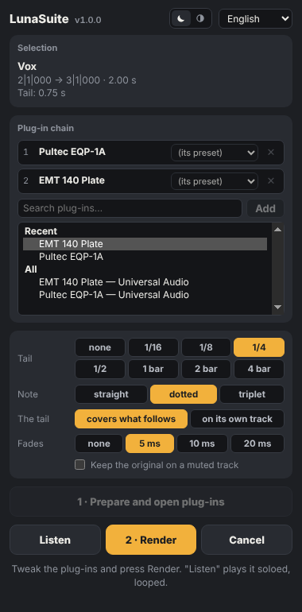
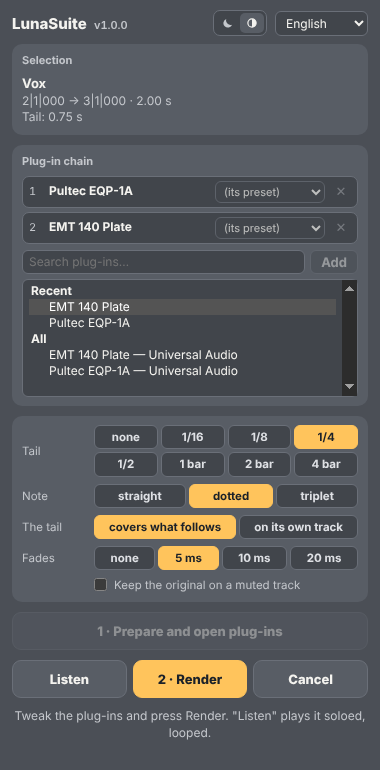

# LunaSuite for LUNA

Render plug-ins onto a selection, AudioSuite style. Select a span on one or more audio tracks,
build a chain of up to three plug-ins, tweak and listen, and press Render: the processed audio
replaces the selection, with a tempo-synced tail if you want one.

  
  

## Features

- **A chain of up to three plug-ins**, each with its own preset. Their windows open so you can
  tweak them before rendering.
- **Listen first:** the selection plays soloed and looped through the chain, tail included.
- **Several tracks at once:** every selected audio track is rendered through the same chain,
  one after another. Tracks in a different format (mono or stereo) from the first are left out,
  and the window says so.
- **Tempo-synced tail:** none, 1/16, 1/8, 1/4, 1/2, or 1, 2 or 4 bars; note values can be
  straight, dotted or triplet. Bars follow the time signature where the selection ends, and the
  tail's length in seconds is shown.
- **Where the tail goes:** it either *covers what follows* on the same track, or goes *on its own
  track* ("name · tail") so the audio after the selection is left untouched.
- **Edge fades** of 5, 10 or 20 ms, or none.
- **Keep the original** on a muted track, if you want a safety copy.
- **Recent and favourite plug-ins** at the top of the list, with search.
- **Plug-ins by manufacturer:** recent and favourites on top, then each manufacturer folds out
  to show its plug-ins; the search opens the ones with a match.
- **Your colour:** yellow, orange, red, green, blue, pink or purple, from the swatch at the top.
- **Starts clean** every time it opens: empty chain and default options.
- **Dark and grey themes.**
- **7 languages:** English, Español, Català, Français, Deutsch, Italiano and Português.

## How to use it

1. In LUNA, select a span on one or more audio tracks.
2. In **LunaSuite**, add plug-ins from the list (double-click or **Add**) and pick a preset for
   each if you like.
3. Choose the tail, where it goes, and the fades.
4. Press **Prepare and open plug-ins**. A temporary track appears with the selection and the
   chain; tweak the plug-ins and press **Listen** to hear it.
5. Press **Render**. The result is laid over the selection and the temporary track is removed.
   Cmd+Z in LUNA undoes it. **Cancel** removes the temporary track without rendering.

The render is LUNA's own bounce: an Add On cannot process audio by itself.

The first time it opens, it asks for your language and then a short guide walks you through the
window in it; the **?** button brings it back whenever you need it.

## Support

If something does not work as expected, Alt-click the version number at the top of the window:
it copies a short report to paste in a message to fedetrillo@gmail.com.

## Install

Requires LUNA 3.1.2 or later. Install it from LUNA's Add On marketplace, or download
`lunasuite.lunaaddon` from the latest release and double-click it. Then open a session and
choose **Add Ons > Windows > LunaSuite**.

## En español

Renderiza plugins sobre una selección, al estilo AudioSuite. Selecciona un trozo de una o varias
pistas de audio, monta una cadena de hasta tres plugins con sus presets, escúchalo en solo y en
bucle, y pulsa Renderizar: el audio procesado sustituye a la selección. La cola va sincronizada
al tempo (1/16 a 4 compases, normal, con puntillo o tresillo) y puede tapar lo que sigue o ir en
una pista aparte. Fundidos de bordes, opción de guardar el original, recientes y favoritos, modo
oscuro y gris, y 7 idiomas.

## Licence

Copyright (c) 2026 Fede Trillo. All rights reserved. Free to install and use in LUNA; the code
may not be copied, modified or redistributed. See [LICENSE](LICENSE). The bundled LUNA Builder
SDK is Universal Audio's, under the Apache License 2.0: see
[THIRD_PARTY_NOTICES.md](THIRD_PARTY_NOTICES.md).

Contact: fedetrillo@gmail.com
